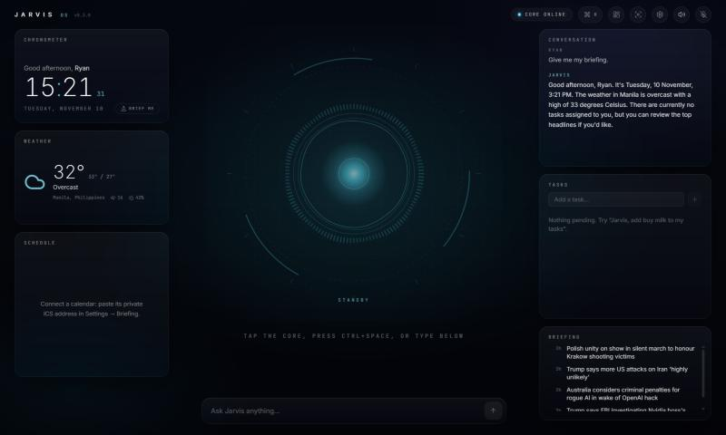

# Jarvis OS

A personal, voice-driven AI dashboard. Say **"Hey Jarvis"** (or your own custom **"Hello Jarvis"**) and it answers, every time, with **"How can I help you Ryan?"** Then it answers your questions with a local AI. While it speaks, a reactive core pulses with every syllable and the captions light up word by word.

The stack is **local-first and zero-cost.** Every component is free and open source and runs on your machine. There are no subscriptions, and no audio leaves the device.



## Highlights

- **Wake word → fixed greeting**, served from cache in under 300 ms. The greeting never goes through the LLM.
- **Streaming answers.** Jarvis speaks the first sentence while the model is still writing the rest.
- **It does things.** Tool calling covers tasks, spoken reminders, long-term memory, weather, encyclopedia lookups, web search, your own documents, and any MCP server.
- **Natural turn-taking.** Interrupt by saying the wake word or by just talking (echo-aware, even through speakers), push-to-talk with Ctrl+Space or Ctrl+Shift+Space system-wide, and earcons that tell you when it is listening.
- **Answers only you** (optional). SpeechBrain voice ID with one-minute in-app enrollment.
- **Reactive visualizer and karaoke captions**, plus a live latency readout for every turn.
- **Editable dashboard**: drag, resize and add widgets (Weather, Schedule, Tasks, News, Memory, Machine, …), a spoken **morning briefing**, a Ctrl+K **command palette**, three **themes**, **focus** and **ambient** modes, and a live **Settings** screen.
- **Engineered properly.** Hexagonal architecture, strict typing (mypy, TypeScript), 170+ tests on fakes, CI, ten ADRs, and docs in Markdown and in code.

## Stack

| Layer        | Technology                                                                |
| ------------ | ------------------------------------------------------------------------- |
| Desktop      | Tauri 2 (Rust shell, global push-to-talk shortcut)                        |
| UI           | React 19, TypeScript, Vite, Tailwind CSS 4, Motion, Zustand, Lucide       |
| Core service | Python 3.12, FastAPI, WebSockets, Pydantic, SQLite                        |
| Wake word    | openWakeWord                                                              |
| Endpointing  | WebRTC VAD, Silero VAD, or a built-in energy VAD                          |
| Speech → text| faster-whisper                                                            |
| Brain        | Ollama (default `llama3.2:3b`) with tool calling; `nomic-embed-text` for memory |
| Text → speech| Kokoro-82M (British voice `bm_george`)                                    |
| Voice ID     | SpeechBrain ECAPA-TDNN (optional)                                         |
| Knowledge    | Open-Meteo, Wikipedia, SearXNG (optional), local documents, MCP servers   |

## Moving to your GPU PC

Follow **[docs/guides/personal-pc-setup.md](docs/guides/personal-pc-setup.md)**: a step-by-step guide from a fresh Windows 11 install to the finished app, with a check after every step and `jarvis-doctor` to verify it all.

## Quick start

Prerequisites: [Node 22+](https://nodejs.org), [uv](https://docs.astral.sh/uv/) and [Ollama](https://ollama.com). For the native window you also need [Rust](https://rustup.rs). [docs/getting-started.md](docs/getting-started.md) covers the details.

```bash
corepack enable                      # provides pnpm
pnpm install
ollama pull llama3.2:3b
ollama pull nomic-embed-text
cd services/core && uv sync --group dev --extra voice && cd ../..
```

Then run two terminals:

```bash
pnpm dev:core      # core service on http://127.0.0.1:8765
pnpm dev           # dashboard on http://localhost:5173  (or: pnpm dev:app for the Tauri window)
```

Click **Engage**, allow the microphone, and say *"Hey Jarvis"*. Then try *"add buy milk to my tasks"*, *"remind me to stretch in ten minutes"* or *"what's the weather in Tokyo?"*.

## Repository layout

```
jarvis-os/
├─ apps/desktop/          React dashboard + Tauri shell (src-tauri/)
├─ services/core/         Python core service (domain / application / adapters / api)
├─ packages/widget-sdk/   Widget manifest types, defineWidget, WidgetRegistry
├─ widgets/               Future standalone widget packages
├─ docs/                  MkDocs site: architecture, guides, ADRs, design system
└─ .github/workflows/     CI: lint, typecheck, test, build, docs
```

## Common commands

| Command                 | What it does                                   |
| ----------------------- | ---------------------------------------------- |
| `pnpm dev` / `dev:core` | Run the UI / the core service                  |
| `pnpm dev:app`          | Run inside the native Tauri window             |
| `pnpm lint`             | ESLint across all TS packages                  |
| `pnpm typecheck`        | `tsc --noEmit` across all TS packages          |
| `pnpm test`             | Vitest across all TS packages                  |
| `pnpm docs`             | Serve the documentation site locally           |
| `uv run pytest`         | Core-service tests (run in `services/core`)    |

## Documentation

- [Getting started](docs/getting-started.md) · [Set up your GPU PC](docs/guides/personal-pc-setup.md) · [Using the dashboard](docs/guides/dashboard.md)
- [Architecture overview](docs/architecture/overview.md)
- [Voice pipeline](docs/architecture/voice-pipeline.md), [brain, tools and memory](docs/architecture/brain.md), and [protocol and REST API](docs/architecture/voice-protocol.md)
- [Configuration reference](docs/configuration.md)
- Guides: [custom "Hello Jarvis" wake word](docs/guides/custom-wake-word.md), [voice ID](docs/guides/voice-id.md), [knowledge sources](docs/guides/web-search.md), [MCP servers](docs/guides/mcp.md), [adding a widget](docs/guides/adding-a-widget.md), [adding a tool](docs/guides/adding-a-tool.md), [swapping an AI component](docs/guides/adding-an-adapter.md)
- [Design system](docs/design/design-system.md), [Roadmap](docs/roadmap.md), [Decision records](docs/adr/index.md)

## License

Private, personal project. Third-party components keep their own licenses (all permissive or open source; see [ADR-0003](docs/adr/0003-local-first-zero-cost-stack.md)).
