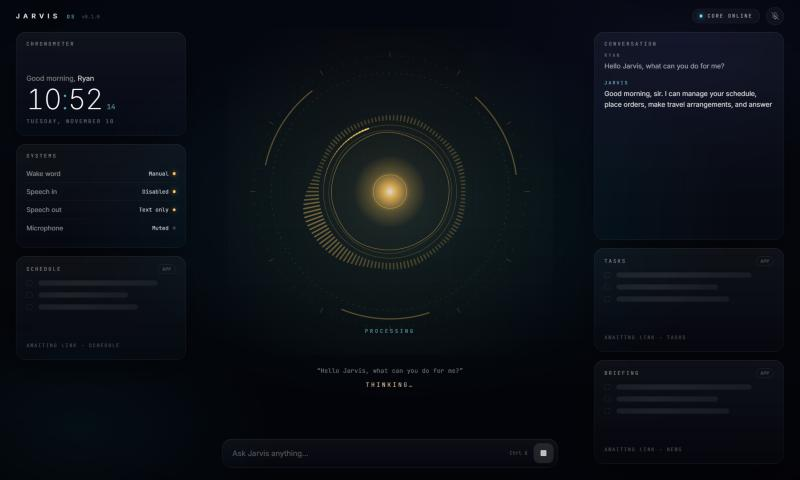

# Jarvis OS

A personal, voice-driven AI dashboard. Say **"Hey Jarvis"** (or your own custom **"Hello Jarvis"**) and it answers, every time, with **"How can I help you Ryan?"** Then it answers your questions with a local AI. While it speaks, a reactive core pulses with every syllable and the captions light up word by word.

The stack is **local-first and zero-cost.** Every component is free and open source and runs on your machine. There are no subscriptions, and no audio leaves the device.



## Highlights

- **Wake word → fixed greeting**, served from cache in under 300 ms. The greeting never goes through the LLM.
- **Streaming answers.** Jarvis speaks the first sentence while the model is still writing the rest.
- **Reactive visualizer.** A Canvas orb is driven by a Web Audio `AnalyserNode`. It reacts to Jarvis's voice when speaking and to yours when listening.
- **Karaoke captions** use per-word timestamps from Kokoro TTS.
- **Modular dashboard** built on a typed widget SDK. Widgets from your future mobile apps already have reserved slots.
- **Hexagonal architecture.** You can swap the LLM, STT, TTS, wake word or VAD by writing one adapter.
- **Engineered properly.** Strict typing (mypy, TypeScript), linters, 80+ tests running on fakes, CI, ADRs, and docs in Markdown and in code.

## Stack

| Layer        | Technology                                                                |
| ------------ | ------------------------------------------------------------------------- |
| Desktop      | Tauri 2 (Rust shell)                                                      |
| UI           | React 19, TypeScript, Vite, Tailwind CSS 4, Motion, Zustand, Lucide       |
| Core service | Python 3.12, FastAPI, WebSockets, Pydantic                                |
| Wake word    | openWakeWord                                                              |
| Endpointing  | WebRTC VAD (or a built-in energy VAD)                                     |
| Speech → text| faster-whisper                                                            |
| Brain        | Ollama (default `llama3.2:3b`)                                            |
| Text → speech| Kokoro-82M (British voice `bm_george`)                                    |

## Quick start

Prerequisites: [Node 22+](https://nodejs.org), [uv](https://docs.astral.sh/uv/) and [Ollama](https://ollama.com). For the native window you also need [Rust](https://rustup.rs). [docs/getting-started.md](docs/getting-started.md) covers the details.

```bash
corepack enable                      # provides pnpm
pnpm install
ollama pull llama3.2:3b
cd services/core && uv sync --group dev --extra voice && cd ../..
```

Then run two terminals:

```bash
pnpm dev:core      # core service on http://127.0.0.1:8765
pnpm dev           # dashboard on http://localhost:5173  (or: pnpm dev:app for the Tauri window)
```

Click **Engage**, allow the microphone, and say *"Hey Jarvis"*.

## Repository layout

```
jarvis-os/
├─ apps/desktop/          React dashboard + Tauri shell (src-tauri/)
├─ services/core/         Python core service (domain / application / adapters / api)
├─ packages/widget-sdk/   Widget manifest types, defineWidget, WidgetRegistry
├─ widgets/               Future standalone widget packages
├─ docs/                  MkDocs site: architecture, guides, ADRs, design system
└─ .github/workflows/     CI: lint, typecheck, test, build, docs
```

## Common commands

| Command                 | What it does                                   |
| ----------------------- | ---------------------------------------------- |
| `pnpm dev` / `dev:core` | Run the UI / the core service                  |
| `pnpm dev:app`          | Run inside the native Tauri window             |
| `pnpm lint`             | ESLint across all TS packages                  |
| `pnpm typecheck`        | `tsc --noEmit` across all TS packages          |
| `pnpm test`             | Vitest across all TS packages                  |
| `pnpm docs`             | Serve the documentation site locally           |
| `uv run pytest`         | Core-service tests (run in `services/core`)    |

## Documentation

- [Getting started](docs/getting-started.md)
- [Architecture overview](docs/architecture/overview.md)
- [Voice pipeline](docs/architecture/voice-pipeline.md) and [protocol](docs/architecture/voice-protocol.md)
- [Configuration reference](docs/configuration.md)
- Guides: [custom "Hello Jarvis" wake word](docs/guides/custom-wake-word.md), [adding a widget](docs/guides/adding-a-widget.md), [swapping an AI component](docs/guides/adding-an-adapter.md)
- [Design system](docs/design/design-system.md), [Roadmap](docs/roadmap.md), [Decision records](docs/adr/index.md)

## License

Private, personal project. Third-party components keep their own licenses (all permissive or open source; see [ADR-0003](docs/adr/0003-local-first-zero-cost-stack.md)).
