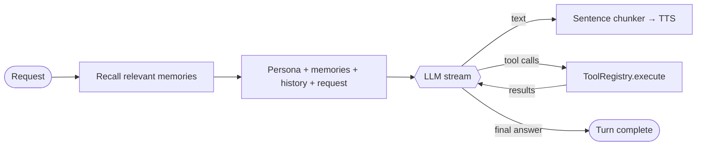

# The brain: tools, memory and knowledge

Phase 3 turned Jarvis from a chat bot into an assistant that *does* things. The `Brain` (`jarvis_core.application.brain`) wraps the language model in a small agent loop.

## The loop

1. **Route.** `ToolRouter` attaches only the tools this request plausibly needs (see below).
2. **Recall.** `MemoryService.relevant(request)` returns up to `memory_top_k` remembered facts, which are added to the end of the system prompt.
3. **Stream.** Text deltas are yielded immediately, so Jarvis starts speaking while it is still deciding.
4. **Act.** If the model asks for tools, each call runs through `ToolRegistry.execute`. The UI shows a label such as *"Checking the weather…"*, and the result goes back to the model as a `tool` message.
5. **Repeat** up to `max_tool_rounds` times (default 4). The final round offers no tools, so the model has to answer in words. The loop always terminates.

Failures never crash a turn. Unknown tools, bad arguments (`ToolError`), exceptions and timeouts (20 s) all come back to the model as `"Error: …"` strings, so it can apologise or ask a follow-up question ([ADR-0007](../adr/0007-tool-calling-agent-loop.md)).

## Tool routing ([ADR-0011](../adr/0011-tool-routing.md))

On a CPU, every attached tool description costs about 1 s of prompt processing. The router groups tools (time, tasks, reminders, memory, weather, encyclopedia, web, documents, and one group per MCP server) and attaches a group only when:

1. one of its keyword patterns matches the request, or
2. the request matches nothing, but the previous user message does. This handles vague follow-ups like "and call dad too" after "add call mum to my tasks", or
3. nothing matched at all, an embedding model is available, and the group's description is similar enough to the request.

Otherwise no tools are attached. Chit-chat turns then cost about 200 prompt tokens instead of about 1,000. Set `JARVIS_TOOL_ROUTING=all` to attach everything, for example on a GPU. To add cues, extend `BUILTIN_GROUPS` in `application/tools/routing.py`.

The system prompt also keeps a stable prefix (date and part of day only, with variable lines last), so Ollama can reuse its prompt cache between turns.

## Built-in tools

| Tool                  | What it does                                    | Backed by                       |
| --------------------- | ----------------------------------------------- | ------------------------------- |
| `get_current_time`    | Local date and time                             | System clock                    |
| `add_task` · `list_tasks` · `complete_task` | To-do list                  | SQLite (`/api/tasks`)           |
| `set_reminder` · `list_reminders` · `cancel_reminder` | Spoken reminders  | SQLite + `ReminderScheduler`    |
| `remember` · `recall` · `forget` | Long-term memory                     | SQLite + embeddings             |
| `get_weather`         | Current conditions and today's high/low         | Open-Meteo (free, no key)       |
| `lookup_encyclopedia` | Background facts                                | Wikipedia REST API (free)       |
| `web_search`          | Current events (optional)                       | Your own SearXNG instance       |
| `search_documents`    | Answers from your own notes (optional)          | Local folder index (RAG)        |
| `<server>__<tool>`    | Anything an MCP server offers (optional)        | [MCP](../guides/mcp.md)         |

Tools that change data (tasks, reminders, memories) broadcast `data_changed`, so the dashboard widgets refresh instantly, whether the change came from voice, the UI or the REST API.

## Memory

- **Storage:** the `memories` table holds the text plus a float32 embedding (BLOB).
- **Embeddings:** Ollama `nomic-embed-text` by default (`ollama pull nomic-embed-text`).
- **Retrieval:** cosine similarity over every memory. At personal scale (hundreds of facts), a brute-force scan takes microseconds and needs no vector database.
- **Graceful fallback:** if the embedding model is missing, memory switches to keyword overlap and logs a warning once.
- **Auditable:** `GET /api/memories` lists everything Jarvis remembers, and `DELETE /api/memories/{id}` removes an entry. You can also say *"forget that my …"*.

## Your documents (local RAG)

Set `JARVIS_DOCUMENTS_DIR` to a folder of `.md` / `.txt` / `.rst` / `.org` files. On start-up, `FolderDocumentIndex`:

1. scans the folder recursively,
2. splits changed files into paragraph-packed chunks of about 800 characters,
3. embeds them in batches and caches them in SQLite (keyed by modification time, so restarts are cheap),
4. serves `search_documents` by cosine similarity.

Indexing runs in the background, so a large folder doesn't delay start-up.

## Reminders

`ReminderScheduler` polls every `JARVIS_REMINDER_POLL_S` seconds (default 5). Due reminders are announced on every connected client through the `SessionHub`:

- if the session is idle, Jarvis says *"Pardon the interruption, Ryan. A reminder: …"* and returns to idle (no follow-up listening);
- if it is busy, the announcement is queued and spoken as soon as the session is idle;
- either way, a `notification` message reaches the UI, which shows it in the Conversation panel and plays a chime.

Polling survives restarts and sleep. A reminder that came due while the service was down is delivered when it starts.

## Persona

`JARVIS_PERSONA_FORMALITY` (`formal` · `balanced` · `casual`), `JARVIS_PERSONA_VERBOSITY` (`brief` · `balanced` · `detailed`) and `JARVIS_PERSONA_HUMOUR` (`none` · `dry` · `playful`) each change one line of the system prompt.

## Choosing a model for tools

Tool calling needs a model that supports it. `llama3.2:3b` does, and runs on CPU, but small models sometimes call tools unnecessarily or phrase arguments loosely. The tools tolerate that: numbers sent as strings are parsed, titles are matched fuzzily, and times can be relative. For noticeably better judgement, use a 7–8B model if you have the hardware.
