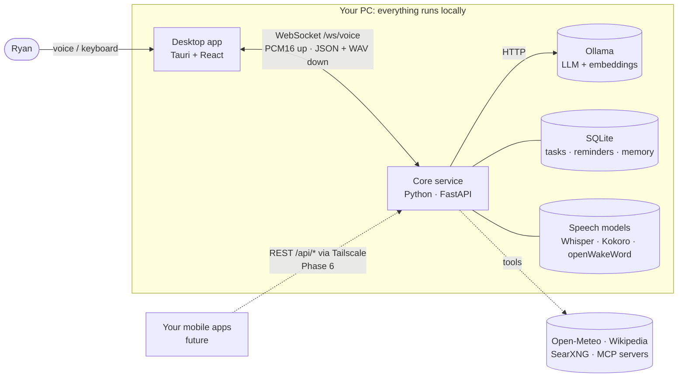
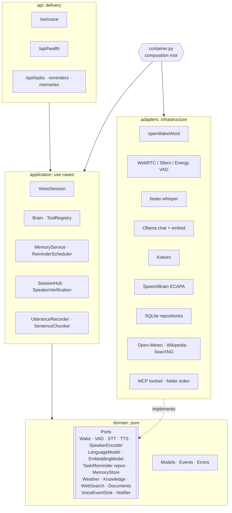

# Architecture overview

## System context



## Containers

| Container        | Responsibility                                                         | Tech                      |
| ---------------- | ---------------------------------------------------------------------- | ------------------------- |
| **Desktop app**  | Rendering, mic capture, audio playback, visualizer, widgets             | Tauri 2, React, Vite      |
| **Core service** | Voice state machine, speech models, LLM orchestration, widget data APIs | Python 3.12, FastAPI      |
| **Ollama**       | Hosts the language model                                                | Ollama                    |

Why split the UI from the core? Speech and AI libraries are Python-first. Keeping them in a service also means the mobile apps can talk to the same brain later ([ADR-0004](../adr/0004-websocket-voice-transport.md)).

## Core service: hexagonal layers



The **dependency rule**: arrows point inward only. `domain` imports nothing from the project, `application` imports only `domain`, and third-party SDKs appear only in `adapters`. `container.py` is the one place that picks an adapter for each port, driven by `Settings`.

This gives three practical benefits:

- **Swappable engines.** A new LLM is one new class plus one line in the container.
- **Fast tests.** The whole voice state machine is tested against fakes in milliseconds, with no models.
- **Optional dependencies.** Adapters import their SDKs lazily, so the service runs in text-only mode without the 2 GB speech stack.

## Desktop app structure

```
src/
├─ core/voice/        VoiceClient (WS) · MicrophoneCapture (worklet) · SpeechPlayer
│                     VoiceAssistant (controller facade) · protocol.ts · hooks
├─ state/             Zustand store + pure conversation reducers
├─ components/hud/    Orb (+ orbRenderer), Captions, CommandBar, StatusBar, EngageOverlay
├─ components/ui/     GlassPanel, StatusDot
├─ dashboard/         registry.ts (what exists) · layout.ts (where) · DashboardZone
└─ widgets/           clock · core-link · conversation · placeholders
```

- `VoiceAssistant` is a **framework-free controller**, the UI-side equivalent of the composition root. React components only read the store and call its methods.
- Per-frame work (the orb at 60 fps, caption tracking) runs in `requestAnimationFrame` loops that read audio state directly, without React re-renders.
- Widgets are **registered** (`registry.ts`) separately from where they are **placed** (`layout.ts`), so a persisted, user-editable layout can drop in later.
- Each widget renders inside an **error boundary**, so one broken tile can't take down the HUD.

## Cross-cutting concerns

| Concern        | Approach                                                                               |
| -------------- | -------------------------------------------------------------------------------------- |
| Configuration  | Typed `pydantic-settings`; Vite env vars typed in `vite-env.d.ts`                       |
| Persistence    | SQLite with versioned migrations ([ADR-0008](../adr/0008-sqlite-persistence.md)); data dir `~/.jarvis-os` |
| Live updates   | `SessionHub` broadcasts `data_changed`; widgets refetch via `useCoreData`               |
| Logging        | `structlog`, either human-readable or JSON                                              |
| Errors         | Adapters raise `JarvisError` subclasses; the session reports them as `error` events     |
| Security       | Loopback bind, WebSocket origin allow-list, strict Tauri CSP, least-privilege capabilities |
| Privacy        | No cloud calls by default; audio never leaves the machine                              |
| Accessibility  | Keyboard control (Ctrl+K, Esc, Enter on the core), `aria-live` captions, reduced-motion support |
