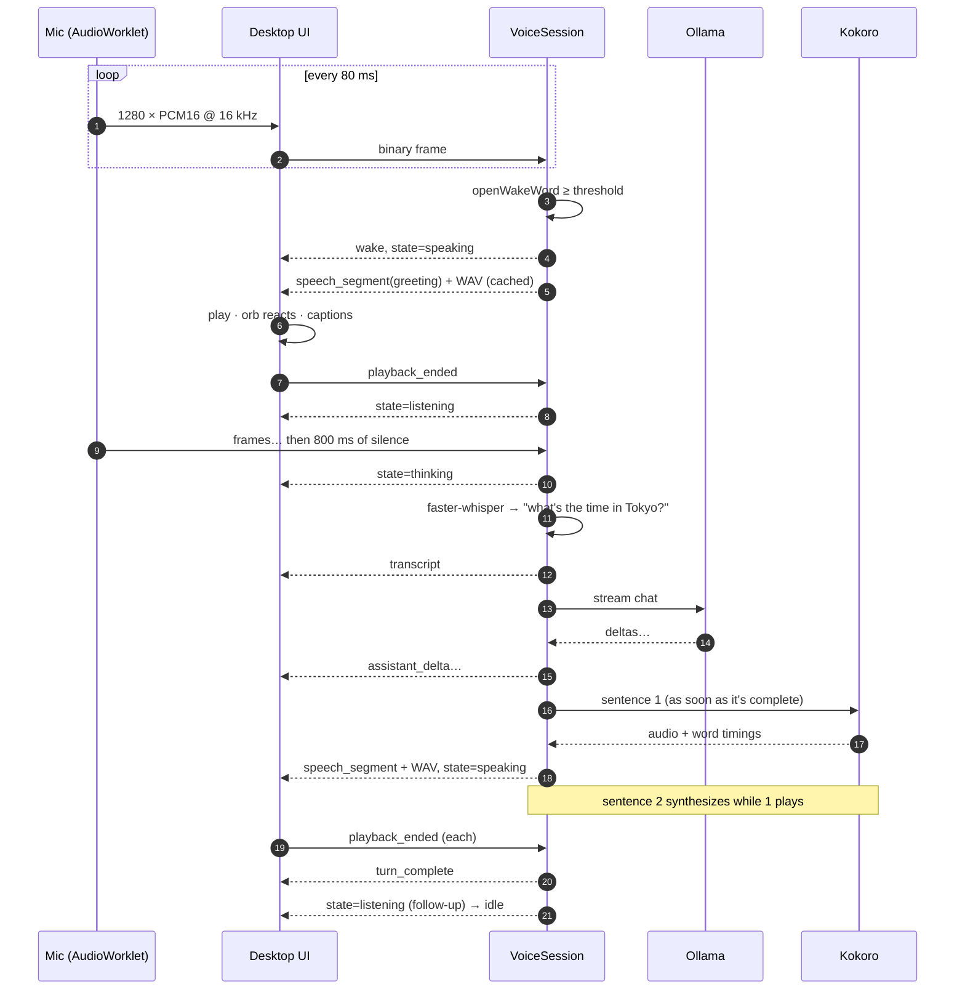
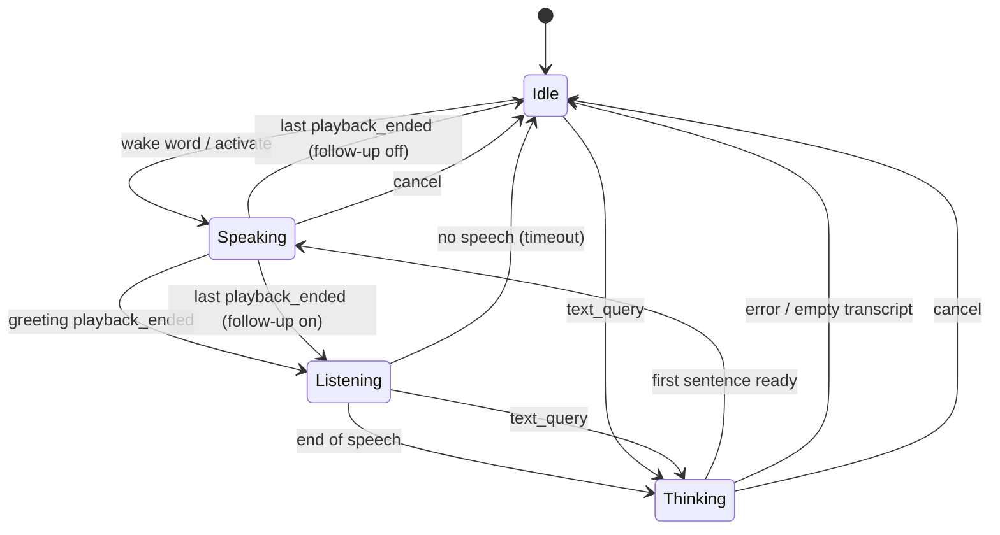

# Voice pipeline

## The conversation loop

## State machine

Implemented in `jarvis_core.application.voice_session.VoiceSession`.

## Design choices

**The greeting is cached, never generated.** `GreetingCache` synthesizes "How can I help you Ryan?" once at startup. It is guaranteed verbatim and plays in under 300 ms.

**Endpointing uses audio time.** `UtteranceRecorder` counts frames rather than reading the wall clock, so its behaviour is deterministic and unit-testable. It keeps about 320 ms of *pre-roll* so your first syllable isn't clipped, and it ignores bursts shorter than 240 ms (coughs, clicks).

**Sentence streaming.** `SentenceChunker` emits sentences from the token stream as soon as they end. A producer/consumer queue lets TTS work on sentence *n* while the LLM writes sentence *n+1*. Time to first audio is roughly STT + LLM-first-sentence + TTS-one-sentence. That's typically 1–2 s on a CPU with `llama3.2:3b`. See [ADR-0006](../adr/0006-sentence-streaming-and-playback-acks.md).

**Text is made speakable.** `to_speakable` strips Markdown, code and URLs before TTS, and the persona prompt asks for plain spoken prose.

**Playback acknowledgements.** The server only knows Jarvis has finished speaking when the client says so (`playback_ended`). This keeps the microphone closed while Jarvis talks, so it doesn't hear itself, and it times follow-up listening correctly.

## The visualizer

The orb (`components/hud/orbRenderer.ts`) is drawn on a 2D canvas at display refresh rate.

- **Input**: `AnalyserNode.getByteFrequencyData` on Jarvis's output while speaking, or on your mic while listening (`VoiceAssistant.levelSource()`).
- **Level**: mean energy of the voice band, passed through `perceptualLevel` (1 − e^(−gx)) with a fast attack and a slow release. That asymmetry is what makes it visibly "bounce" on each word.
- **Layers**: ambient glow, compass ticks and rotating arcs, 128 mirrored spectrum bars, a liquid membrane whose ripple amplitude follows the level, and the luminous core.
- **States**: colour cross-fades over about 250 ms. Idle cyan breathes slowly, listening turns mint, thinking turns gold with a chasing comet, and speaking is bright cyan.

Captions use the per-word timestamps from Kokoro. `SpeechPlayer` records when each segment actually starts on the `AudioContext` clock, and `activeWordIndex` binary-searches the current word every frame.

## Latency budget (CPU-only laptop, indicative)

| Stage                         | Typical      |
| ----------------------------- | ------------ |
| Wake → greeting audio         | < 300 ms     |
| End-of-speech detection       | 800 ms (configurable) |
| Whisper `base.en`, 3 s clip   | 300–700 ms   |
| LLM first sentence (3B)       | 400–1200 ms  |
| Kokoro, one sentence          | 200–600 ms   |
