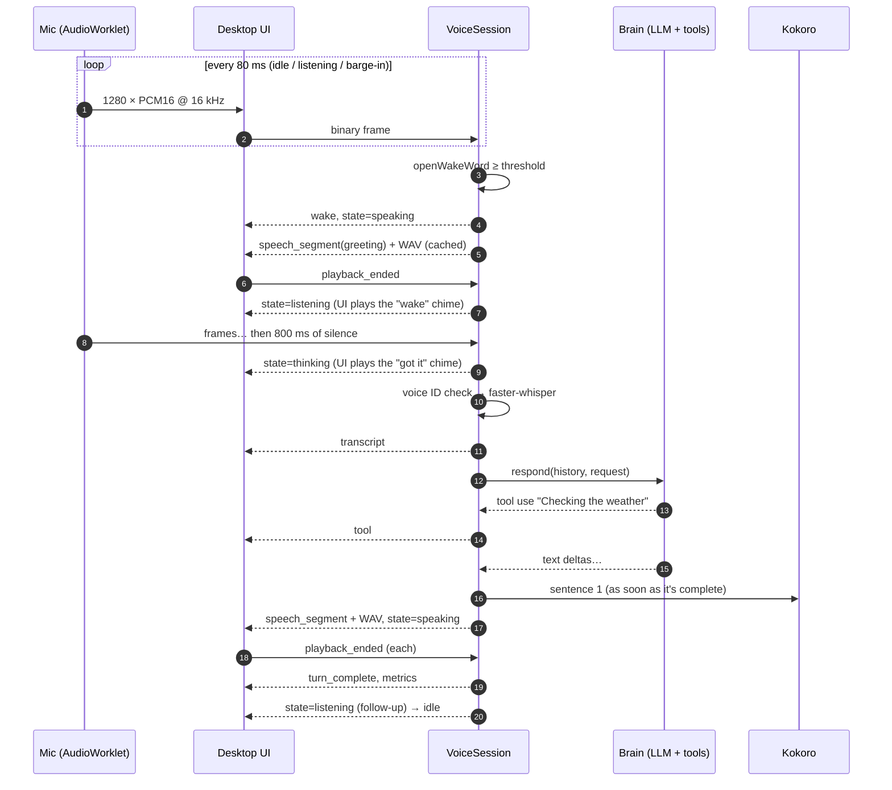
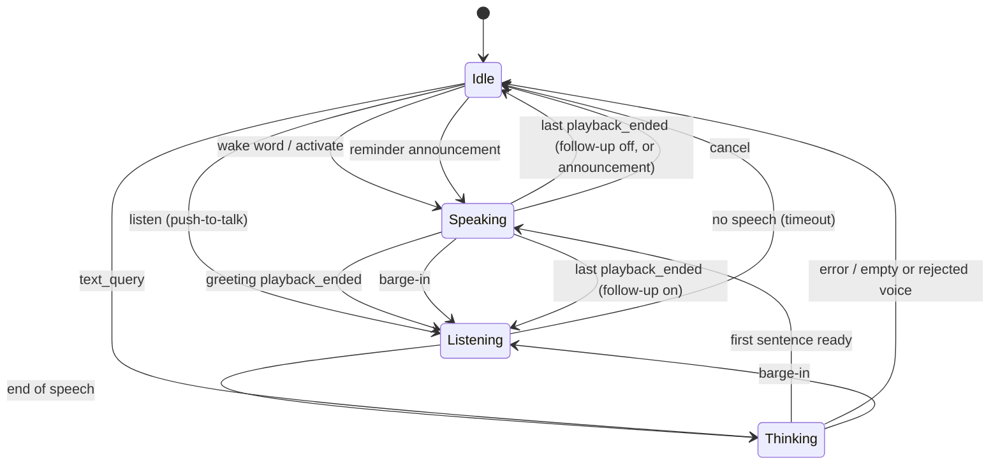

# Voice pipeline

## The conversation loop

## State machine

Implemented in `jarvis_core.application.voice_session.VoiceSession`.

## Design choices

**The greeting is cached, never generated.** `GreetingCache` synthesizes "How can I help you Ryan?" once at startup. It is guaranteed verbatim and plays in under 300 ms.

**Endpointing uses audio time.** `UtteranceRecorder` counts frames rather than reading the wall clock, so it is deterministic and unit-testable. It keeps about 320 ms of pre-roll so the first syllable isn't clipped, and it ignores bursts shorter than 240 ms.

**Sentence streaming.** `SentenceChunker` emits sentences from the token stream as soon as they end, and a producer/consumer queue synthesizes sentence *n* while the brain writes *n+1* ([ADR-0006](../adr/0006-sentence-streaming-and-playback-acks.md)).

## Phase 2 additions

### Barge-in ([ADR-0009](../adr/0009-barge-in-and-playback-watchdog.md))

While Jarvis is **thinking or speaking**, the UI keeps streaming the mic so you can interrupt:

| `JARVIS_BARGE_IN` | Trigger | Notes |
| --- | --- | --- |
| `wake_word` (default) | Say the wake word again | Robust: Jarvis's own voice rarely contains "Hey Jarvis" |
| `voice` | Speak over Jarvis for ≥ `JARVIS_BARGE_IN_MIN_SPEECH_MS` (400 ms) | The client's echo-aware detector learns how much of Jarvis leaks into the mic and fires only when you are clearly louder ([ADR-0013](../adr/0013-echo-aware-barge-in.md)); the wake word also works |
| `off` | — | Use Esc or the stop button |

On barge-in, the session cancels generation, sends `interrupted` (the UI stops playback at once) and starts listening. In `voice` mode, the speech that triggered the interruption is already part of the new request.

### Push-to-talk

`listen` skips the wake word and the greeting. Press **Ctrl+Space** in the window, or **Ctrl+Shift+Space** anywhere in Windows when running in Tauri (a global shortcut registered in `src-tauri/src/lib.rs`).

### Playback watchdog

Each speech segment arms a timer: its expected end (segments play back-to-back) plus `JARVIS_PLAYBACK_GRACE_MS`. If the client never acknowledges it, because a tab was suspended or audio failed, the session treats it as played and moves on, so Jarvis can't get stuck "speaking".

### Earcons

Short synthesized tones (`core/audio/earcons.ts`, Web Audio, no files) mark the moments you'd otherwise have to look for: Jarvis starts listening, Jarvis heard you, a notification, an error. Toggle them with the speaker icon in the status bar; the setting is persisted.

### Latency metrics

Every turn ends with a `metrics` message: speech recognition time, time to first token, time to first audio, and total time, measured from the end of your speech. The Systems widget shows the last turn's numbers, and the core logs them (`turn_metrics`).

### Voice ID ([ADR-0010](../adr/0010-voice-id.md))

With `JARVIS_SPEAKER_VERIFICATION=true`, each utterance is embedded with SpeechBrain ECAPA and compared with your enrolled voiceprint before transcription. Voices below the threshold are ignored. The UI briefly shows *"Voice not recognised"* and plays a low tone. See [Voice ID](../guides/voice-id.md).

## The visualizer

The orb (`components/hud/orbRenderer.ts`) is drawn on a 2D canvas at display refresh rate, from `AnalyserNode` data: Jarvis's output while speaking, your mic while listening. Fast-attack and slow-release smoothing make it bounce on each word. Captions use Kokoro's per-word timestamps against the `AudioContext` clock.

## Latency budget (CPU-only laptop, indicative)

| Stage                         | Typical      |
| ----------------------------- | ------------ |
| Wake → greeting audio         | < 300 ms     |
| End-of-speech detection       | 800 ms (configurable) |
| Voice ID check (if enabled)   | 50–150 ms    |
| Whisper `base.en`, 3 s clip   | 300–700 ms   |
| LLM first sentence (3B, CPU)  | ~1.5 s without tools; ~6–8 s when a tool is used (two model calls) |
| Kokoro, one sentence          | 200–600 ms   |
