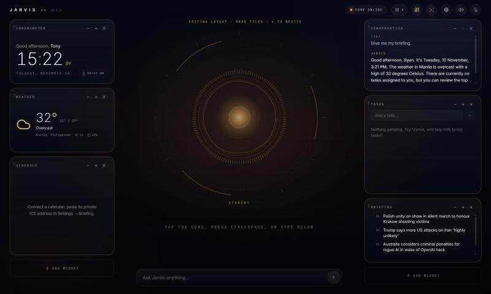

# Using the dashboard

## Layout

Click the **layout icon** in the top bar (or **Ctrl+K → Edit layout**). Every tile then shows edit controls:

- **Drag** a tile to reorder it or move it to the other side. A glowing line shows where it will land.
- **− / +** changes its height in rows. The fourth step, *Fill height*, makes it take the remaining space.
- **×** removes it. **Add widget** at the bottom of each side opens the gallery.

The layout is saved to the core service (`/api/ui-preferences/layout`), with a local copy in the browser. It follows you between the desktop app and a browser tab, and it survives reinstalls as long as `~/.jarvis-os` is kept.

| Widget | What it shows | Needs |
| --- | --- | --- |
| Chronometer | Time, date, greeting, **Brief me** button | — |
| Weather | Current conditions, high/low | Home location (Settings → Brain) |
| Schedule | Today's and tomorrow's events | A calendar ICS address (Settings → Briefing & feeds) |
| Conversation | The current transcript | — |
| Tasks | Open tasks and upcoming reminders | — |
| Briefing | Latest headlines | News feeds (defaults: BBC World, NPR) |
| Memory | What Jarvis remembers; hover a fact to forget it | — |
| Machine | CPU, RAM and GPU (VRAM) load | — |
| Systems | Wake word, speech, barge-in, tools, mic, voice ID, latency | — |

## Command palette: Ctrl+K

Type to filter actions: briefing, talk, edit layout, add widget, settings, focus mode, ambient mode, mic, sounds, themes and voice-ID training. Anything that isn't a command becomes a question: type it and press **Enter** to ask Jarvis.

## Themes

Choose one in **Settings → Appearance** or from the palette. Each theme recolours the whole interface, orb included.

- **Arctic**: cool cyan on midnight (default)
- **Stark Gold**: red and gold
- **Stealth**: monochrome and low-glare

## Focus mode

The **focus icon** hides every widget and leaves only the core, captions and command bar. Reminder chimes are muted, but reminders still appear in the transcript and are still spoken.

## Ambient mode

After a period of inactivity (Settings → Appearance; 10 minutes by default), the HUD fades to a large, dim clock. Any key, mouse movement or the wake word brings it back.

## Morning briefing

There are three ways to get one:

- Say *"Good morning, Jarvis"* or *"brief me"*.
- Click **Brief me** on the Chronometer, or use **Ctrl+K → Morning briefing**.
- Have it delivered automatically every day: **Settings → Briefing & feeds → Daily spoken briefing** (e.g. 07:30).

The briefing combines weather, the rest of today's calendar, open tasks, today's reminders and three headlines. Missing sources are skipped. A scheduled briefing is delivered once per day: if no window is open at that time, it waits up to three hours for one.

### Connecting your calendar (free, no OAuth)

- **Google:** calendar.google.com → ⚙ Settings → your calendar → *Integrate calendar* → **Secret address in iCal format**.
- **Outlook.com:** Settings → Calendar → Shared calendars → *Publish a calendar* → ICS link.
- **Apple iCloud:** share the calendar as a public calendar and copy the `webcal://` link.
- **Any `.ics` file:** paste its full path.

Paste one address per line in **Settings → Briefing & feeds → Calendars**. Secret addresses work like passwords: Jarvis stores them only in your local database and never logs them in full.
