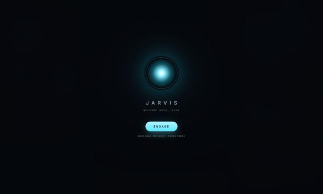

# Jarvis OS

Jarvis OS is a personal operating surface: a full-screen dashboard of widgets with a voice-driven AI at its centre.

## What it does today (Phase 1)

| Capability              | How                                                                  |
| ----------------------- | -------------------------------------------------------------------- |
| Always-on wake word     | openWakeWord listens locally for "Hey Jarvis" (or your custom model) |
| Fixed greeting          | "How can I help you Ryan?", synthesized once and replayed instantly  |
| Understanding speech    | WebRTC VAD finds the end of your sentence; faster-whisper transcribes |
| Answering               | A local LLM via Ollama, streamed sentence by sentence                |
| Speaking                | Kokoro TTS with per-word timestamps                                  |
| Looking alive           | Canvas orb driven by the live audio spectrum, plus karaoke captions  |
| Typing instead          | Command bar, or the Ctrl+K palette. Esc interrupts                   |
| Dashboard               | Widget SDK + registry; editable layout, nine built-in widgets        |

## Phase 4 (v0.3.0)

An editable dashboard with Weather, Schedule, Briefing (news), Memory and Machine widgets; a spoken morning briefing; Ctrl+K command palette; Arctic / Stark Gold / Stealth themes; focus and ambient modes; a live Settings screen; echo-aware barge-in; and the desktop app launches the core itself.

**Moving to your GPU PC?** Follow [Set up your GPU PC](guides/personal-pc-setup.md).

## Where to go next

- New here? Start with [Getting started](getting-started.md).
- To understand the design, read the [Architecture overview](architecture/overview.md).
- To extend it, see the [Guides](guides/adding-a-widget.md).
- For past decisions and their reasons, see the [Decision records](adr/index.md).
